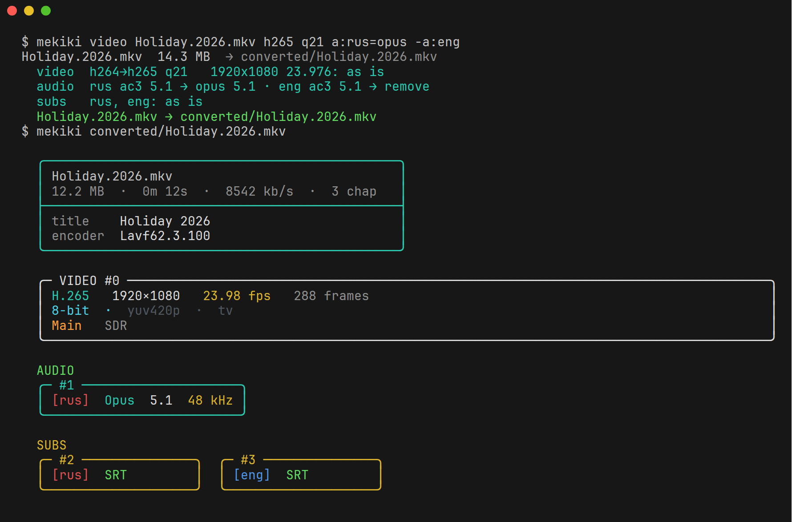
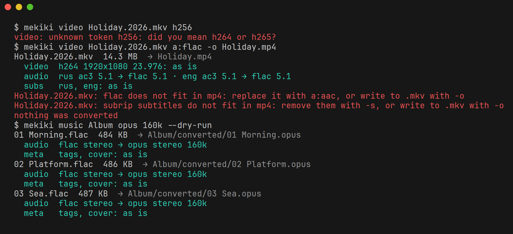
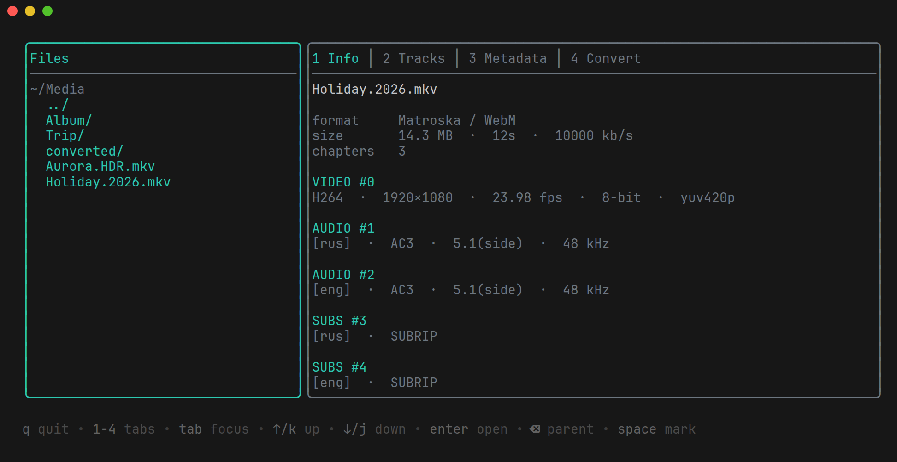

# mekiki

[](https://github.com/Mimic890/mekiki/actions/workflows/ci.yml)
[](https://pkg.go.dev/github.com/Mimic890/mekiki)
[](LICENSE)

Terminal media toolkit powered by [FFmpeg](https://ffmpeg.org/). Say what to change; everything else is kept.



- **Inspect** codecs, stream sizes, frame rate, HDR metadata, audio and subtitle tracks, language tags and image EXIF data.
- **Change only what you name** with short tokens: `mekiki video film.mkv h265 q21 a:rus=opus -a:eng`. Everything else is kept.
- **Convert** files with built-in or custom presets and full control over ffmpeg, including GPU encoders, in a parallel queue.
- **Edit metadata** of containers, tracks and photos with `mkvpropedit`, `exiftool` or an `ffmpeg` remux.
- **Embed it**: the same engine is a set of [Go packages](#use-as-a-go-library).

Every command has `--json` output with a versioned schema and documented exit codes, so scripts and agents can drive it.

## Quick start

Three levels of control over one engine. `shrink` and the token commands print a plan before anything runs; `--explain` adds the exact ffmpeg commands.

```sh
mekiki shrink ./Videos                               # no knowledge needed: smaller files, nothing else changes
mekiki video film.mkv h265 q21 a:rus=opus -a:eng     # name the changes with tokens
mekiki convert film.mkv --preset hevc --crf 20 -o out/   # full control over ffmpeg
```

Without `-o`, results go into a `converted` directory next to each input, and no existing file is replaced without `--overwrite`. Anything that needs a decision stops the run with a hint instead of a guess:



## Install

**Binaries** for Linux, macOS and Windows (amd64 and arm64) come with [GitHub releases](https://github.com/Mimic890/mekiki/releases) made by the release workflow, with a `SHA256SUMS` file. Unpack and put `mekiki` on your `PATH`.

**With Go** 1.26 or newer:

```sh
go install github.com/Mimic890/mekiki@latest
```

**FFmpeg** is required (`ffprobe`, and `ffmpeg` for conversions and remuxing). [MKVToolNix](https://mkvtoolnix.download/) (`mkvpropedit`) for in-place Matroska edits and [ExifTool](https://exiftool.org/) for photo metadata (required by `mekiki photo`) are optional. `mekiki doctor` lists what is installed and which GPU encoders work.

| System | Command |
| --- | --- |
| Debian, Ubuntu | `sudo apt install ffmpeg mkvtoolnix libimage-exiftool-perl` |
| Fedora | `sudo dnf install ffmpeg mkvtoolnix perl-Image-ExifTool` (FFmpeg from RPM Fusion) |
| Arch | `sudo pacman -S ffmpeg mkvtoolnix-cli perl-image-exiftool` |
| macOS | `brew install ffmpeg mkvtoolnix exiftool` |
| Windows | `winget install Gyan.FFmpeg`, optionally `MoritzBunkus.MKVToolNix` and `OliverBetz.ExifTool` |

**Tab completion** of commands, flags, tokens and preset names, next to file names:

| Shell | Add to the shell's startup file |
| --- | --- |
| bash | `source <(mekiki completion bash)` in `~/.bashrc` |
| zsh | `source <(mekiki completion zsh)` in `~/.zshrc`, after `compinit` |
| fish | `mekiki completion fish \| source` in `~/.config/fish/config.fish` |

## Usage

```text
mekiki <command> [flags] [args]
```

| Command | Purpose |
| --- | --- |
| `info [path...]` | Show media information (default command) |
| `shrink <path...>` | Make files smaller, keeping everything else |
| `video <path...> <tokens>` | Change only what the tokens name |
| `photo <path...> <tokens>` | The same for photos |
| `music <path...> <tokens>` | The same for music |
| `convert <input...> -o <output>` | Convert with full control over ffmpeg settings |
| `preset <command>` | List, show, save, remove or edit presets |
| `meta get\|set\|rm <file...>` | Read or edit container, track and image tags |
| `doctor` | Check external tools, their versions and GPU presets |
| `tui [dir]` | Open the terminal interface |
| `version` | Print the version (also `-v`, `--version`) |

`mekiki <path...>` is shorthand for `mekiki info <path...>`. To inspect a file literally named like a command, use `mekiki info ./info`.

Flags may appear before or after positional arguments; `--` ends flag parsing. `-h` prints a command's flags. The CLI never asks questions interactively.

### info

```text
mekiki info [--json] [-r] [file|directory...]
```

| Invocation | Behavior |
| --- | --- |
| `mekiki` | Inspect media files in the current directory |
| `mekiki ./Movies` | Inspect media files in one directory |
| `mekiki file.mkv` | Show a detailed view of one file |
| `mekiki a.mkv b.mp4 ./Music` | Inspect several files and directories |

Directory scans skip hidden entries and discover media by file extension. They take subdirectories only with `-r`, which skips hidden and `converted` folders. Every file is attempted; failures are reported after the rest are shown (see exit codes).

Each `ffprobe` process has a 30-second timeout. Paths are passed as explicit local inputs, and filenames and metadata are sanitized before terminal output.

Output covers:

- File size, duration, overall bitrate, chapters, and common metadata
- Video codec, resolution, average frame rate, frame count, bit depth, pixel format, color range, bitrate, and stream size
- HDR10, HDR10+, HLG, and Dolby Vision data when reported by `ffprobe`
- Audio codec, channels, sample rate, bitrate, stream size, and detectable Atmos or DTS:X profiles
- Subtitle format, language, forced flag, title, and stream size
- Still-image dimensions, pixel format, bit depth, and camera, lens, exposure and GPS tags

For images, tags come from `exiftool` when it is installed (EXIF, IPTC, XMP, GPS and maker notes; one exiftool process serves the whole run) and from `ffprobe` otherwise.

### video, photo, music

```text
mekiki video [flags] <file|directory...> <tokens...>
mekiki photo ./trip webp 2000px q85 -exif
mekiki music ./album opus 160k
```

Everything is kept; each token changes one thing. The plan fills in the rest so that nothing is lost: resolution, frame rate, color, HDR, chapters, subtitles and tags stay as they are, and a track is encoded only if a token asks for it.

| Token | Meaning |
| --- | --- |
| `h265` (`hevc`), `h264`, `av1` | Video codec |
| `webp`, `jpeg` (`jpg`), `avif`, `png` | Photo format |
| `opus`, `aac`, `mp3`, `flac` | Music format |
| `q21`, `good`, `best` | Quality, in the encoder's own scale; a value out of its range is an error. `good` is the default |
| `1080p`, `2000px`, `50%` | Size: fit into the 1920x1080 box (either orientation), limit the longest side, or scale. Only a percentage can enlarge |
| `30fps` | Frame rate |
| `gpu` | The first GPU preset of that codec that passes a test encode. Never falls back to the CPU |
| `a:opus`, `a:192k` | Codec or bitrate of all audio tracks (also `ac3`, `eac3`, and `copy` to keep a track) |
| `a:rus=opus`, `a:rus=192k` | The same for one language; it wins over the all-tracks token |
| `160k` | Music bitrate, the same as `a:160k` |
| `-a:eng` | Remove the tracks of a language |
| `-s` | Remove all subtitles |
| `-exif` | Remove metadata: global tags (video), all tags and the cover (music), everything but the orientation and ICC profile (photo) |

Tokens are told from files by their form. To convert a file literally named like a token, write `./h265`. An unknown token, two tokens setting the same thing, or a token that does not apply to the verb is an error with a hint; nothing is guessed.

| Flag | Meaning |
| --- | --- |
| `-o PATH` | Output file or directory. Default: a `converted` directory next to each input |
| `--explain` | Print the plan and the final `ffmpeg` and `exiftool` commands, and exit |
| `--dry-run` | Print the plan and exit |
| `--save NAME` | Save the tokens as a preset (with `--yes`, replace one); without files it only saves |
| `--overwrite`, `-j N`, `--fail-fast`, `-r` | As in `convert` |

**The plan** is printed before the run (to stderr, or stdout with `--explain` and `--dry-run`) as a diff against the source:

```text
film.mkv  4.2 GB  → converted/film.mkv
  video  hevc→h265 q21   1920x1080 23.976 10bit HDR10: as is
  audio  rus ac3 5.1 → opus 5.1 · eng dts → remove
  subs   rus, eng: as is
```

What the planner fills in:

- A source above 8 bits keeps its pixel format. HDR10 and HLG metadata go to x265 as explicit parameters, read from the stream or its first frame; other encoders rely on ffmpeg 7+ to pass them on. A GPU encoder may drop mastering display data, and HDR10+ and Dolby Vision layers cannot be re-encoded: the plan warns about each. Dolby Vision without a compatible base layer is refused, since its colors would break.
- Scaling honors display rotation. Rotated phone videos stay undistorted.
- A track already in the named codec is copied, unless a bitrate or quality is named too.
- Music gets the bitrate of the built-in preset of its format, unless named. Tags and the cover are kept; for Ogg outputs the cover is written as a `METADATA_BLOCK_PICTURE` comment.
- Photos keep all EXIF, XMP and IPTC tags, the ICC profile and the Orientation tag with unrotated pixels. This needs `exiftool`; `photo` exits with code 4 without it.

**Anything that needs a decision stops the whole run** with exit code 2 and nothing written: a codec that does not fit the container (`flac` in `mp4`: use `a:aac` or write to `.mkv`), subtitles the container does not take, an output name that contradicts the format. Warnings, such as `5.1` mixed down for `mp3` or transparency lost in `jpeg`, do not stop the run.

**Presets are tokens too.** `mekiki video h265 q21 a:opus --save myhevc` stores the set; then `mekiki video film.mkv myhevc a:192k` uses it. Manual tokens win over a preset's. Such a preset works only with its own verb, and `convert --preset` rejects it.

Cover art stays cover art: Matroska outputs attach the original picture again instead of making it a video track. Limits: only the first video stream is encoded; other video streams are copied. Languages are matched literally against the track's tag. Photos must have a format ffmpeg can read, and `gif` is refused because it may be animated.

### shrink

```text
mekiki shrink [flags] <file|directory...>
```

Needs no knowledge at all: video becomes `h265`, photos `webp` and music `opus`, the same plan as the tokens would give, with everything else kept. A result that is not smaller is thrown away and reported as `skipped`, with exit code 0. Files that cannot be converted are skipped with a message. Flags as in `video`, without `--save`.

### convert

Full control: every encoder option by hand, with the same engine as the commands above.

```text
mekiki convert [flags] <input...> -o <output>
```

Inputs are files or directories: their media files, and with `-r` those of every subfolder too, except hidden and `converted` folders and the output directory. `-o` then keeps the tree: `Music/Album/01.flac` becomes `out/Album/01.opus`. With one input file, `-o` is the output file. With several inputs, a directory input, an existing directory, or a path ending in `/`, `-o` is an output directory: each output is named after its input with the preset's container as extension. The directory is created if needed.

| Flag | Meaning |
| --- | --- |
| `-o PATH` | Output file or directory (required) |
| `--preset NAME` | Start from a preset; the flags below override its fields |
| `--vcodec`, `--acodec`, `--scodec` | Encoder per stream type, e.g. `libx265`, `hevc_nvenc`, `copy` |
| `--crf N` | Constant quality for the main stream (video, or audio for audio presets), mapped per encoder |
| `--vbitrate`, `--abitrate` | Bitrates, e.g. `6M`, `192k` |
| `--encoder-preset` | Video encoder speed preset, e.g. `slow`, `p5` |
| `--pix-fmt` | Video pixel format, e.g. `yuv420p10le` |
| `--track SEL` | Track to keep (repeatable): `all`, stream index `N`, `v`, `a`, `s`, `t`, `TYPE:N`, `TYPE:all`; `-TYPE` or `-TYPE:N` removes tracks picked earlier. Default: all tracks |
| `--container EXT` | Output extension for directory output |
| `--load CLASS` | Load class: `cpu-heavy`, `light`, `gpu`, `io` |
| `--ffmpeg-arg ARG` | Extra raw ffmpeg output argument (repeatable) |
| `-j N`, `--jobs N` | Parallel jobs: a number or `auto` (default) |
| `--fail-fast` | Cancel the remaining jobs after the first failure |
| `--overwrite` | Replace existing outputs, including the input itself |
| `-r` | Take the subfolders of directory inputs too |
| `--dry-run` | Print the ffmpeg commands and exit |

Without `--preset`, every track is copied (`-c copy`) and only the given flags change that. `--crf` maps to `-crf` (x264, x265, SVT-AV1, libaom, VP9), `-cq` (NVENC), `-global_quality` (QSV), `-qp` (VAAPI), `-qp_i`/`-qp_p` (AMF), `-quality` (WebP) or `-q` (JPEG, LAME); other encoders reject it.

Video encoders apply to video tracks only; attachments and other tracks are copied. Cover art is copied too; a Matroska output keeps it as an attachment. One exception: ffmpeg encodes the cover of a Matroska source going to MP4 with the video track, so drop it with `--track` or use `mekiki video`, which handles it. Global metadata and chapters are kept by ffmpeg's defaults.

**Safety.** ffmpeg writes to a hidden temp file next to the output (`.name.*.part.ext`), which is renamed into place only after success. An existing output, including the input itself, is replaced only with `--overwrite`. ffmpeg runs without a shell and without stdin. Ctrl+C stops every running job, removes their temp files and exits with 130. Conversions have no timeout.

**Parallel queue.** Every preset has a load class. With `--jobs auto`, each class has its own limit and jobs of different classes run side by side; a light job may start while a cpu-heavy job waits. With `--jobs N`, at most N jobs of any class run, in queue order. Each job gets `cores / limit` CPU threads (`-threads`, plus `pools` for x265 and `lp` for SVT-AV1). A failed job does not stop the others unless `--fail-fast` is set.

| Load class | Auto limit |
| --- | --- |
| `cpu-heavy` | 1 |
| `light` | number of CPU cores |
| `gpu` | 2 |
| `io` | 2 |

**Progress.** Text mode writes progress and per-file results to stderr: a live block on a terminal, finished files only otherwise. With `--json`, stdout carries JSON Lines (see below).

Image inputs: ffmpeg reads JPEG, PNG, WebP, TIFF, BMP, GIF, AVIF and HEIC/HEIF. DNG is decoded only partially, and camera RAW formats (CR2, CR3, NEF, ARW, RAF, ORF) are not supported. `convert` does not carry over EXIF metadata; `mekiki photo` does.

### preset

```text
mekiki preset list [--json]
mekiki preset show [--json] <name>
mekiki preset save [convert flags] [--preset BASE] [--description TEXT] [--media TYPE] [--yes] <name>
mekiki preset rm --yes <name>
mekiki preset edit
```

`list` hides GPU presets that fail a short test encode on this machine. `save` stores the given convert flags as a user preset; `--preset` becomes its `extends`. Replacing an existing user preset needs `--yes`, as does `rm`. `edit` opens the presets file in `$VISUAL` or `$EDITOR` and validates it afterwards.

Built-in presets (read-only):

| Media | Presets |
| --- | --- |
| Video | `h264` (x264 CRF 20, AAC), `hevc` (x265 CRF 22), `av1` (SVT-AV1 CRF 30), `remux` (copy) |
| Video, GPU | `hevc-nvenc`, `av1-nvenc`, `hevc-qsv`, `av1-qsv`, `hevc-amf`, `av1-amf`, `hevc-vaapi`, `av1-vaapi` |
| Audio | `opus` (160k), `aac` (256k, M4A), `mp3` (VBR V2), `flac` |
| Image | `jpeg`, `png`, `webp`, `avif` |

Video presets write MKV and copy audio unless noted. Audio presets keep audio tracks only. Image presets keep the first image. VAAPI presets use `/dev/dri/renderD128`.

### Configuration files

Both files live in the user config directory (`$XDG_CONFIG_HOME/mekiki/` or `~/.config/mekiki/` on Linux, `~/Library/Application Support/mekiki/` on macOS).

`presets.yml` holds a list of user presets. A user preset with a built-in's name overrides it for the CLI; built-in presets never see user overrides.

```yaml
- name: hevc-hq                  # lowercase letters, digits, '.', '_', '-'
  description: HEVC for archiving
  extends: hevc                  # inherit, then override the fields below
  media: video                   # video | audio | image
  container: mkv                 # extension for directory output
  load: cpu-heavy                # cpu-heavy | light | gpu | io
  video: {codec: libx265, crf: 18, preset: slow, pixFmt: yuv420p10le, args: [-tune, grain]}
  audio: {codec: libopus, bitrate: 192k}
  subtitle: {codec: copy}
  tracks: [v, a, "s:all", -s:0]  # default: all tracks
  inputArgs: [-hwaccel, cuda]    # raw args before -i
  args: [-movflags, +faststart]  # raw output args
```

`config.yml` changes the automatic job limits:

```yaml
jobs:
  cpu-heavy: 2
  gpu: 3
```

### meta

```text
mekiki meta get [--json] [-r] <file|directory...>
mekiki meta set [flags] <file...> KEY=VALUE...
mekiki meta rm  [flags] <file...> KEY...
```

`get` (with `-r`, also for subfolders) shows container tags, every track with its selector (`v:0`, `a:1`, `s:0`), `default`/`forced` flags and tags, and, for images, MP4 and MOV, all exiftool tags by group (`IFD0`, `ExifIFD`, `GPS`, `XMP-dc`, `IPTC`, maker notes, ...).

`set` and `rm` take the files first (arguments that exist on disk), then the tags. They never change an input unless `--in-place` is given; otherwise `-o` names the output file, or a directory for several inputs.

| Flag | Meaning |
| --- | --- |
| `-o PATH` | Write the result here; the input stays untouched |
| `--in-place` | Change the input files themselves |
| `--overwrite` | Replace an existing `-o` output |
| `--track SEL` | Edit a track (`v:N`, `a:N`, `s:N` or stream index) instead of the container |
| `--from FILE` | `set` only: copy all tags from FILE first (images, MP4, MOV) |
| `--group NAME` | `rm` only: clear an exiftool group such as `GPS` or `XMP` (repeatable; images, MP4, MOV) |
| `--dry-run` | Print the backend command without changing anything |

The keys `default` and `forced` set track flags and take `1`/`0`, `yes`/`no` or `true`/`false`. Other keys are tag names: `title` and `language` for tracks, any container tag such as `title`, `artist` or `comment`, and exiftool tag names for images (`Artist`, `XMP-dc:Title`, `GPSLatitude`).

```sh
mekiki meta set movie.mkv --in-place title="My Movie"
mekiki meta set movie.mkv --in-place --track s:0 language=rus forced=1 default=0
mekiki meta rm ./Photos/*.jpg --group GPS -o ./clean/
mekiki meta set edited.jpg --from original.jpg --in-place
```

Backends:

| File | Backend |
| --- | --- |
| Images (JPEG, PNG, WebP, TIFF, HEIC, AVIF, GIF, DNG and camera RAW) | `exiftool` |
| MP4, MOV, M4V, 3GP with group keys (`Keys:Make`), `--group` or `--from` | `exiftool` |
| Matroska (`mkv`, `mka`, `webm`) with `--in-place`, editing the container title or a track's `title`, `language`, `default`, `forced` | `mkvpropedit`, edits in place without rewriting the file |
| Everything else, including MP3 and FLAC | `ffmpeg` remux with `-c copy` |

ffmpeg and exiftool write a temp file next to the target and rename it only on success, so `--in-place` never leaves a half-written file and exiftool never leaves `*_original` backups. mkvpropedit edits the Matroska header in place by design. Batches use one exiftool process (`-stay_open`). A track that does not exist is an error. exiftool writes fail when a tag is unknown, not writable, or has an invalid value.

### doctor

```text
mekiki doctor [--json]
```

Checks `ffprobe`, `ffmpeg`, `mkvpropedit` and `exiftool`: whether each is in `PATH` and which version it reports. It also test-encodes a short clip with every GPU preset, since an encoder listed by ffmpeg may still lack the hardware or driver. Exits with code 4 if `ffprobe` or `ffmpeg` is missing; the optional `mkvpropedit` and `exiftool` and the GPU results do not affect the exit code. Commands that do not need a missing tool keep working.

### tui

```text
mekiki tui [dir]
```



Opens a full-screen interface in `dir` (default: the current directory): a file browser on the left and the Info, Tracks, Metadata and Convert tabs on the right. It starts only with this command and needs stdin and stdout to be a terminal; it exits with code 2 otherwise. `--json` is not supported.

| Key | Action |
| --- | --- |
| `1`–`4` | Switch tabs |
| `tab` | Move focus between the file browser and the tab |
| `↑`/`↓` or `k`/`j` | Move the cursor |
| `enter`, `→` / `⌫`, `←` | Open a directory / go to the parent (browser) |
| `space` | Mark a file for conversion (browser) |
| `q`, `ctrl+c` | Quit; a running queue is stopped first and its temp files removed |

**Metadata** lists container tags (or image tags by group) and every track with its tags. `enter` edits a value, `a` adds `KEY=VALUE` to the selected container or track, `d` deletes a tag, `t` and `f` toggle a track's default and forced flags, `u` drops all pending changes. Changes stay pending until `w`, which shows them with the exact commands; then `y` writes in place, `c` writes a `name.edited.ext` copy (an existing copy is never overwritten) and `esc` goes back. Moving to another file drops pending changes.

**Convert** picks a preset with `←`/`→` (only presets usable on this machine) and overrides its fields with `enter`; an empty field keeps the preset value. `r` converts the marked files, or the selected one, into the output directory (default `converted/` under the starting directory) with the same queue as `convert`; existing outputs are never overwritten. Each job shows a progress bar, plus a total. `+` and `-` change the number of parallel jobs, `0` returns to automatic limits; a new count applies to jobs started afterwards. `x` stops the queue. `s` saves the current preset and overrides as a user preset that extends it.

## Terminal output

Colors and box frames are drawn only when stdout is a terminal. Piped output is plain text. Set [`NO_COLOR`](https://no-color.org/) to any non-empty value to disable colors in a terminal.

Data goes to stdout; errors and logs go to stderr.

## JSON output

Every command accepts `--json`. Documents are printed to stdout and always carry `schemaVersion`. The version changes only on breaking changes; new fields may be added without a bump.

`info --json`:

```json
{
  "schemaVersion": 1,
  "files": [
    {
      "filePath": "/media/demo.mkv",
      "fileName": "demo.mkv",
      "fileSize": 1048576,
      "durationMs": 10250,
      "format": "matroska,webm",
      "formatLong": "Matroska / WebM",
      "bitrateBps": 818400,
      "chapters": 2,
      "tags": { "title": "Demo" },
      "video": [ { "index": 0, "codec": "hevc", "width": 3840, "height": 2160, "fps": 23.976, "bitDepth": 10, "hdr": { "isHdr10": true } } ],
      "audio": [ { "index": 1, "codec": "eac3", "channels": 6, "language": "eng", "isAtmos": true } ],
      "subtitle": [ { "index": 2, "codec": "subrip", "language": "rus", "forced": true } ]
    }
  ],
  "errors": [ { "path": "/media/broken.mp4", "error": "ffprobe failed on \"broken.mp4\": ..." } ]
}
```

The stream objects are abbreviated above; the full field list is in [`testdata/info.golden`](testdata/info.golden). `files`, `errors`, `video`, `audio` and `subtitle` are always arrays, never `null`.

`doctor --json`:

```json
{
  "schemaVersion": 1,
  "tools": [
    { "name": "ffprobe", "found": true, "path": "/usr/bin/ffprobe", "version": "7.1" },
    { "name": "mkvpropedit", "found": false, "error": "mkvpropedit not found in PATH; install MKVToolNix" }
  ],
  "gpuPresets": [
    { "name": "hevc-nvenc", "encoder": "hevc_nvenc", "ok": true },
    { "name": "hevc-amf", "encoder": "hevc_amf", "ok": false, "error": "encoder hevc_amf is not included in this ffmpeg build" }
  ]
}
```

`convert --json` prints one event per line, as do `video`, `photo`, `music` and `shrink`. Every line has `schemaVersion`, `jobId`, `type`, `input` and `output`. `type` is `start` (with `threads`), `progress` (with `progress`), `done`, `skipped`, `failed` or `canceled` (the last three with `error`). `percent` and `durationMs` are 0 when the input duration is unknown.

```json
{"schemaVersion":1,"jobId":1,"type":"start","input":"a.mkv","output":"out/a.mkv","threads":4}
{"schemaVersion":1,"jobId":1,"type":"progress","input":"a.mkv","output":"out/a.mkv","progress":{"outTimeMs":1500,"durationMs":3000,"percent":50,"fps":120,"speed":4.8,"sizeBytes":65536}}
{"schemaVersion":1,"jobId":1,"type":"done","input":"a.mkv","output":"out/a.mkv"}
{"schemaVersion":1,"jobId":2,"type":"failed","input":"b.mkv","output":"out/b.mkv","error":"ffmpeg failed on \"b.mkv\": ..."}
```

`meta get --json` prints `{"schemaVersion":1,"files":[{"path","tags","tracks":[{"index","selector","type","codec","default","forced","tags"}],"groups":{...}}],"errors":[...]}`; `groups` appears only when exiftool read the file. `meta set|rm --json` prints `{"schemaVersion":1,"results":[{"path","output","backend","command"}],"errors":[...]}`, where `command` is set with `--dry-run`. See [`testdata/meta-get.golden`](testdata/meta-get.golden) and [`testdata/meta-edit.golden`](testdata/meta-edit.golden).

In `info --json`, image files carry an `exif` object with the same groups, and every track has `default` and `tags`.

`convert --dry-run --json` prints `{"schemaVersion":1,"jobs":[{"jobId","input","output","preset","load","threads","command":["ffmpeg",...]}]}`; see [`testdata/convert-dry-run.golden`](testdata/convert-dry-run.golden). The command shows the final output path; the real run writes to a temp file first. `video`, `photo` and `music` with `--dry-run --json` or `--explain --json` print the same document, where each job also has `plan` (`{"lines":[{"kind","text"}],"warnings":[...]}`) and, for photos, `post` with the exiftool command.

`preset list --json` prints `{"schemaVersion":1,"presets":[...],"unavailable":[{"name","error"}]}`, and `preset show --json` prints `{"schemaVersion":1,"preset":{...}}` with the fields of `presets.yml` plus `source` (`builtin` or `user`); see [`testdata/preset-show.golden`](testdata/preset-show.golden).

On failure with `--json`, stderr receives one JSON line:

```json
{"schemaVersion":1,"error":{"code":"tool_missing","message":"ffprobe not found in PATH; install FFmpeg"}}
```

## Exit codes

| Code | `error.code` | Meaning |
| --- | --- | --- |
| 0 | | Success |
| 1 | `error` | The operation failed (for batches: every item failed) |
| 2 | `usage` | Invalid arguments or flags |
| 3 | `partial` | Some items of a batch failed, others succeeded |
| 4 | `tool_missing` | A required external tool is not installed |
| 130 | `interrupted` | Stopped by Ctrl+C or SIGTERM |

## Use as a Go library

The CLI is a thin layer over packages that other programs can import. Each package documents itself on [pkg.go.dev](https://pkg.go.dev/github.com/Mimic890/mekiki), with runnable examples.

| Package | What it does |
| --- | --- |
| [`pkg/probe`](https://pkg.go.dev/github.com/Mimic890/mekiki/pkg/probe) | Run `ffprobe` and get typed streams: codecs, HDR, languages, rotation, chapters |
| [`pkg/convert`](https://pkg.go.dev/github.com/Mimic890/mekiki/pkg/convert) | Tokens, presets, the per-file planner, the ffmpeg runner and the parallel queue |
| [`pkg/meta`](https://pkg.go.dev/github.com/Mimic890/mekiki/pkg/meta) | Read and write container, track and photo tags |
| [`pkg/tools`](https://pkg.go.dev/github.com/Mimic890/mekiki/pkg/tools) | Find `ffmpeg`, `mkvpropedit` and `exiftool` and report their versions |

The `mekiki video film.mkv h265 q21 a:rus=opus -a:eng` pipeline in code:

```go
lib, _ := convert.LoadLibrary("") // built-in presets only; pass a path for a presets.yml
spec, err := lib.ParseSpec(convert.MediaVideo, []string{"h265", "q21", "a:rus=opus", "-a:eng"})
if err != nil {
	return err // unknown or conflicting token, with a hint
}
info, err := probe.ScanFileContext(ctx, "film.mkv")
if err != nil {
	return err
}
jobs, err := convert.PlanContainers([]string{"film.mkv"}, "out/",
	[]string{lib.ContainerFor(convert.MediaVideo, spec)}, false)
if err != nil {
	return err
}
var plan *convert.FilePlan
jobs[0].Preset, plan = lib.Compose(ctx, convert.MediaVideo, spec, info, jobs[0].Output)
if len(plan.Problems) > 0 {
	return errors.New(strings.Join(plan.Problems, "; ")) // a decision for the user
}
return convert.Run(ctx, jobs[0], 0, func(p convert.Progress) { fmt.Printf("\r%.0f%%", p.Percent) })
```

For batches, `convert.Queue` runs jobs in parallel with per-load-class limits and reports `Event`s. A `Library` serves concurrent `Compose` calls; only `Save` and `Remove` need exclusive access. The packages call the external tools as subprocesses, so they need them installed; nothing links against FFmpeg. The module is below 1.0: exported names may still change between minor versions, and the release notes say when they do.

## Security model

- External tools run without a shell, with explicit argument lists. Input paths reach ffmpeg as files, never as protocol URLs: a file named `pipe:1.mkv` or `concat:a|b` is read as a file.
- Outputs are written to a hidden temp file next to the target and renamed into place only on success. An existing file, the input included, is replaced only with `--overwrite` or `--in-place`.
- File names and tags are sanitized before they reach the terminal, so a crafted name cannot inject escape sequences.
- `presets.yml` is trusted local configuration: its `args` and `inputArgs` go to ffmpeg verbatim. Do not load preset files from untrusted sources.

## Development

```sh
gofmt -l .                 # must print nothing
go vet ./...
go test -race ./...
go build ./...
```

CI also runs [`staticcheck`](https://staticcheck.dev/) and [`govulncheck`](https://go.dev/doc/security/vuln/). Integration tests generate tiny media files with `ffmpeg -f lavfi` and are skipped when the needed tool is missing. Regenerate golden files with `go test . -update`. Tests point `XDG_CONFIG_HOME` and `HOME` at temp dirs, so they never touch your presets.

The screenshots come from real runs on generated media: `docs/screenshots.sh` rebuilds them (it needs tmux, [freeze](https://github.com/charmbracelet/freeze) and Chrome or Chromium).

A release is a pushed `vX.Y.Z` tag: the release workflow builds the binaries and publishes them with notes generated from the commits.

## License

[MIT](LICENSE)
